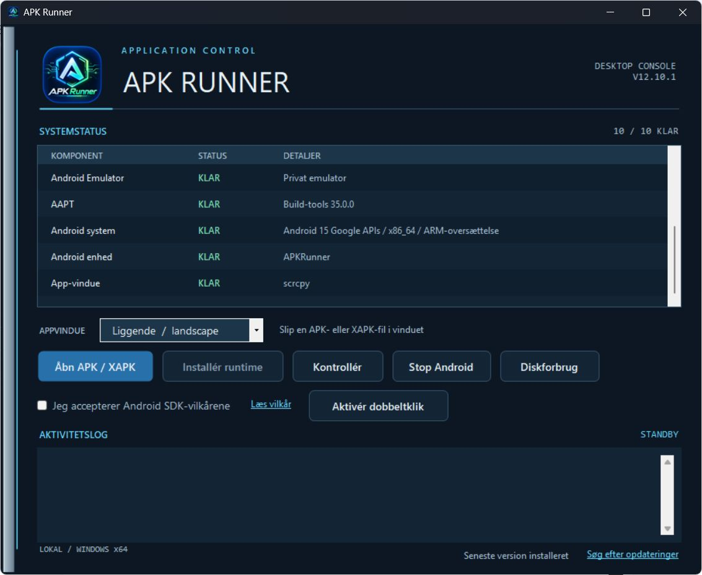

<p align="center">
  
</p>

# APK Runner

**Run compatible Android APK and XAPK apps on a Windows PC, with a desktop launcher that handles Android setup, installation, and app windows.**

APK Runner combines the Android Emulator, ADB, and scrcpy behind a Windows interface. Choose an app package, let Android start, and use the app with your mouse and keyboard. The 12.11.0 release uses English throughout the launcher, including setup, component status, activity messages and update notifications.

**[Download for Windows](https://github.com/MiMat82/APK-Runner/releases/latest)** · **[User guide](docs/USER-GUIDE.md)** · **[Build from source](docs/BUILDING.md)** · **[Report a problem](https://github.com/MiMat82/APK-Runner/issues)**

This repository contains the maintained application source, build and packaging scripts, tests, and artwork under the [MIT License](LICENSE). Android tools and other dependencies retain their own licenses; see [third-party notices](THIRD-PARTY-NOTICES.md).

## App screenshot



*Historical screenshot of APK Runner 12.10.1 on Windows, showing its earlier Danish interface with the runtime configured. The 12.11.0 release uses English labels; this image has not yet been replaced with a screenshot of that version.*

## What it can do

| Feature | What it does |
| --- | --- |
| Open APK and XAPK files | Select a file, drag it into the launcher, or enable Windows double-click handling. |
| Set up Android components | Downloads and checks Java, Android SDK tools, emulator, a system image, and scrcpy after you accept the SDK terms. |
| Handle split packages | Installs APK files inside XAPK archives together and copies supported OBB expansion files. |
| Show Android app windows | Uses scrcpy for mouse/keyboard interaction and audio playback. |
| Choose an orientation | Offers portrait and landscape modes. Individual apps may enforce their own orientation. |
| Choose a performance profile | Normal and High Performance profiles set different CPU/RAM allocations for the virtual device. |
| Check runtime readiness | Shows component status and an activity log to help diagnose setup and launch problems. |
| Create desktop shortcuts | Creates a shortcut for a launched app, pointing back to its original APK/XAPK file. |
| Review storage usage | Shows the space used by the Android runtime and virtual-device files. |
| Update the launcher | Setup-installed versions check stable GitHub releases and can download, verify, and apply updates. |
| Keep Android data separate | Launcher update files are separate from the runtime, installed apps, and saved data. |

## Requirements

- **Windows x64:** the app checks for Windows 10 22H2 / build 19045 or newer, including Windows 11 x64. This is the application's compatibility check, not a statement about Microsoft's support lifecycle.
- **.NET Framework 4.8**, used by the Windows launcher.
- **Working hardware virtualization and emulator acceleration.** Windows Hypervisor Platform may need to be enabled, followed by a reboot.
- **Internet for first setup and updates.** Android apps may have their own network requirements.
- **Room for an Android emulator:** system images, virtual disks, apps, and snapshots can use many gigabytes. The small Windows installer does not include these downloads. A universal minimum RAM/disk requirement has not been established.

APK Runner targets Intel/AMD Windows x64 PCs. Windows on ARM is not a supported target.

## Quick tutorial: run your first app

These button names describe the English interface in the 12.11.0 release. Earlier releases use different labels.

1. **Install the launcher.** Open [Releases](https://github.com/MiMat82/APK-Runner/releases/latest), expand **Assets** if needed, download **`APKRunner-win-Setup.exe`**, and install it. GitHub's **Source code** archives are for building, not installing the Windows app.
2. **Choose new or existing data.** At first launch, choose **No** for a new Android installation. If you already use APK Runner, choose **Yes** and select your original APK Runner folder or its `runtime` folder to reuse your apps and data.
3. **Set up Android.** Start with **Normal**. Open **Read terms**, select **I accept the Android SDK terms**, then click **Install runtime**. Wait for required components to show **READY**. Use **Check runtime** to check again.
4. **Pick the display mode.** Choose **Portrait** for a tall window or **Landscape** for a wide one.
5. **Open your package.** Click **Open APK / XAPK**, choose a compatible `.apk` or `.xapk`, and wait for installation and the app window. You can also drag one package into the launcher. The first Android boot can take several minutes.
6. **Use and reopen the app.** Use your mouse and keyboard. Keep the original package in a stable folder: the generated desktop shortcut references that file.

For detailed setup steps, button meanings, data locations, and troubleshooting, read the [full user guide](docs/USER-GUIDE.md).

## Compatibility

APK Runner uses emulation. Compatibility and speed depend on the app, its native libraries, the system image, and your PC.

- **x86_64:** handled by the primary runtime.
- **arm64-v8a:** supported through translation where the runtime can run it; this is not native ARM execution or a guarantee for every ARM64 app.
- **32-bit x86:** routed through a separate legacy Android TV runtime, downloaded when needed.
- **ARM32-only apps:** rejected by the current launcher.
- **`.aab`, `.apks`, and `.apkm`:** not accepted input formats. A plain APK or supported XAPK is required.

Apps requiring a physical device, particular Google services, device integrity checks, DRM, or unsupported hardware can fail. There is no promise that every Android app or game will work. The project does not supply Android app downloads or a bundled Play Store.

## Updates and saved data

Setup-installed versions check at startup, every six hours while open, and through **Check for updates**. Once a newer stable version is detected, new app launches are blocked until it is installed. Already running Android sessions continue. In 12.11.0, local component checks run alongside the network update check, so component status can appear without waiting for GitHub.

Save your work and close Android sessions before choosing **Update and restart**. In 12.11.0, **Stop Android** gracefully stops both APK Runner's phone and legacy TV devices after checking their identities; it refuses to stop unrelated emulators. Earlier 12.10.x versions stop only the phone runtime. The updater checks for active Android processes before applying an update.

An ordinary launcher update does not bundle or replace Android data disks. Back up important data, and keep any existing runtime folder you registered during setup. See the [user guide](docs/USER-GUIDE.md) for details.

The **12.11.0 installer is not Authenticode-signed** and may show a Windows publisher warning. This unsigned release is an explicit maintainer decision; package integrity checks remain enabled. Building the source does not create a trusted publisher signature.

## Build and contribute

The project is a C# Windows Forms application targeting .NET Framework 4.8 and x64. On Windows with a compatible .NET SDK:

```powershell
git clone https://github.com/MiMat82/APK-Runner.git
Set-Location APK-Runner
powershell.exe -NoProfile -File .\Build-App.ps1
```

The output is `artifacts\updater-app\APKRunner.exe`, with dependency DLLs beside it. Read [BUILDING.md](docs/BUILDING.md) for prerequisites, tests, packaging, signing, and fork configuration; [ARCHITECTURE.md](docs/ARCHITECTURE.md) for a source map; and [CONTRIBUTING.md](CONTRIBUTING.md) to contribute.

The 12.11.0 release source includes the English interface, concurrent startup checks and rounded branding. Release tags identify the source commit used for each new official package. Historical 12.10.0 assets predate the open-source publication and are not claimed to be byte-for-byte reproducible from this source.

## Repository contents

| Path | Contents |
| --- | --- |
| `src/preview/` | Maintained launcher, runtime management, UI, storage reporting, and updater. The directory name is historical. |
| `src/launcher/` | Compatibility forwarder for older launcher paths. |
| `tools/` | Build, packaging, signing, branding, and runtime maintenance scripts. |
| `tests/` | Regression checks and isolated updater integration probes. |
| `assets/branding/` | Application PNG and multi-size Windows ICO. |
| `docs/` | User/developer guides and repository banner. |
| `release/` | Version, release notes, and placeholder signing configurations. |
| `licenses/` | Bundled dependency license notices. |

The repository includes the files needed to build the maintained application. Generated binaries, downloaded Android/Java tools, virtual devices, installed APKs, saved data, historical local analysis, and signing credentials are excluded.

## License

APK Runner's code, documentation, and project artwork use the [MIT License](LICENSE). You may use, modify, redistribute, and sell copies while preserving the license and copyright notice. Third-party components remain subject to their own terms.
