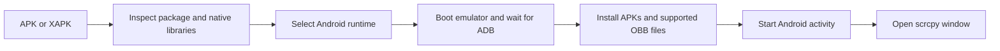

# Architecture and source map

APK Runner is a Windows Forms application targeting .NET Framework 4.8 and x64. It coordinates external Android tools; it does not implement its own Android emulator.

## App launch flow

The primary runtime uses Android 15 (API 35) Google APIs x86_64. Legacy 32-bit x86 apps use Android 14 (API 34) TV x86. ARM64 compatibility depends on translation. ARM32-only native apps are rejected.

## Maintained source

| File in `src/preview/` | Responsibility |
| --- | --- |
| `APKRunner.cs` | Entry point, runtime readiness/setup, package inspection, emulator/ADB orchestration, installation, shortcuts and file associations. |
| `WindowLayout.cs`, `WindowSizing.cs` | Controls, scrolling and initial screen sizing. |
| `ModernUi.cs`, `Branding.cs`, `ShellBranding.cs` | Theme, visual controls, embedded artwork and shell icons. |
| `RuntimeSetup.cs`, `RuntimePaths.cs` | Existing-runtime selection and persistent data locations. |
| `AppUpdates.cs`, `UpdatePolicy.cs`, `UpdateUi.cs` | Velopack integration, required-update policy and UI. |
| `StorageReport.cs`, `NativeStorage.cs`, `NativeFileLocation.cs` | Storage accounting and Windows filesystem helpers. |

The `preview` name is historical: the main project builds these files. `src/launcher/Forwarder.cs` is a compatibility launcher for older executable paths; it is not required for the main executable.

The core source was recovered from the author's own V12.9 executable and then maintained in source form. The historical recovered analysis snapshot is not a build input. Decompiled naming in some core routines remains a refactoring opportunity.

## Data and updates

Settings live under `%LocalAppData%\APKRunnerData`. Android data defaults to its `runtime` subfolder; `runtime-path.txt` can register an existing runtime elsewhere. Android data stays outside the replaceable managed app folder.

The runtime contains SDK components, Java, scrcpy, AVD configuration/disks, caches/logs, and optional backups. Installed Android apps and data live inside virtual-device disks. The Windows executable is not a backup of them.

Velopack updates the Windows launcher from stable releases. A detected newer stable version gates new launches; existing sessions continue. Applying an update checks for Android processes and takes the runtime operation lock. Network failure alone does not invent an update requirement; an already discovered required version remains cached.

## Current boundaries

- Setup contacts Adoptium, Google and GitHub, and invokes SDK manager after consent.
- An unmanaged source executable does not enable automatic updates merely by starting.
- **Stop Android** targets the primary phone runtime, not the legacy TV device.
- A machine-specific marker enables optional tuned rendering; it is not a universal performance default.
- Maintenance tools can change compression, snapshots or configuration. Review their parameters against the intended runtime before using them.
- Fixture checks and successful builds do not establish compatibility with every app, every PC, or a clean-machine installation.
